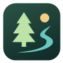
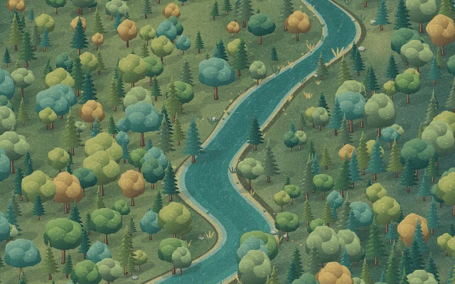

# Sylvaframe



**Adaptive Windows wallpapers that make desktop icons part of the scenery.**

Sylvaframe is an independent fork of Deskland Preview. It adds independently rendered wallpapers for extended displays and includes 11 usable themes. Move a desktop icon and the shoreline, cloud, lawn, or clearing around it changes. Each theme renders locally.

[Windows downloads](https://github.com/XiaoyuZhuang/Deskland/releases/latest) · [简体中文](#中文说明) · [Build from source](#build-from-source)



## Themes

| Theme | Scenery |
| --- | --- |
| Beach | An icon-shaped coastline with waves, palms, seabirds, and kayaks |
| Meadow | Grassland with drifting clouds, a kite, and a black cat |
| Forest | A woodland creek and clearings that follow your icons |
| Lotus Pond | Leaves and blossoms make room for icons as koi swim around them |
| Pink Forest | Watercolor trees, birds, and clearings around icons |
| Old Map | Icons form seas on parchment, while wagons travel between towns |
| Ocean | Green islands form around icons in deep blue water with sailboats |
| Maldives | Pale sand islands, mint shallows, reefs, palms, and fish schools |
| Sky | Icons sit on puffy clouds at day, dusk, or night |
| Hand-drawn City | Lawns follow icons and the green canal reroutes around them |
| Nautical Chart | Parchment islands, harbors, lighthouses, shipping routes, and a sea monster |

The theme browser puts the 11 usable themes first. Lake and Colorful City are locked previews.

## Run on Windows

Sylvaframe supports 64-bit Windows 10 and Windows 11 and uses Microsoft Edge WebView2 Runtime. The latest published Windows packages are on this fork’s [Releases page](https://github.com/XiaoyuZhuang/Deskland/releases/latest). For a portable ZIP, extract the whole archive and run `Start-Forest.cmd` from the extracted folder.

Open Settings from the tray icon to choose a theme. Theme settings save automatically. The tray also offers pause, reload, start on sign-in, and exit. Exiting restores the original wallpaper. Sylvaframe saves its settings and logs under `%LOCALAPPDATA%\Sylvaframe`.

Each extended display renders only its own icons. Settings preview and sharing use the primary display. Shared images and animations substitute sample icons and label shapes for real filenames.

## Build from source

Open PowerShell in the repository root and run:

```powershell
powershell -ExecutionPolicy Bypass -File host\build.ps1
.\Start-Forest.cmd
```

The build uses the Windows .NET Framework C# compiler and downloads the WebView2 SDK the first time. Keep `host/` and `prototype/` together. The executable is written to `host/bin/`.

To build the Windows installer, run:

```powershell
powershell -ExecutionPolicy Bypass -File tools\build-installer.ps1
```

The first installer build downloads portable NSIS and the signed WebView2 bootstrapper. The installer, file manifest, and SHA-256 checksum are written under `dist/`. The installer targets the current user’s `Programs\Sylvaframe` directory.

## Browser preview

With Node.js installed, run `node prototype\serve.mjs` and open [the local settings page](http://localhost:5178/settings.html). The browser preview uses sample icons. The Windows host supplies real desktop icon positions.

## Credits and license

Thanks to **BLEZZ0102** and the Deskland contributors for the Windows host and the original Beach and Meadow themes. [Upstream Deskland](https://github.com/BLEZZ0102/Deskland)

The project is released under [GPL-3.0](LICENSE). See the [third-party notices](THIRD_PARTY_NOTICES.md), [trademark notes](TRADEMARKS.md), and [this fork’s issue tracker](https://github.com/XiaoyuZhuang/Deskland/issues).

---

## 中文说明

**让桌面图标成为风景的一部分。**

Sylvaframe 是 Deskland Preview 的独立 fork。它支持扩展多屏，每块屏幕单独渲染，并根据本屏的桌面图标调整风景。移动图标时，岛屿、云团、草坪或林间空地会随之变化。壁纸在本地实时绘制。

[Windows 下载](https://github.com/XiaoyuZhuang/Deskland/releases/latest) · [English](#sylvaframe) · [从源码运行](#从源码运行)

### 可用主题

| 主题 | 场景 |
| --- | --- |
| 沙滩 | 海岸线随图标变化，岸边有海浪、椰子树、海鸥和皮划艇 |
| 草地 | 云团和云影在草地上移动，还有风筝和小黑猫 |
| 森林 | 小溪穿过树林，林间空地跟随图标 |
| 荷塘 | 荷叶和荷花让开图标，锦鲤游过留下涟漪 |
| 粉色森林 | 水彩树冠轻摆，小鸟在树梢间飞过，图标周围自动留白 |
| 老地图 | 羊皮纸大陆随图标形成海域，马车沿虚线道路在城镇间往返 |
| 大海 | 图标周围形成绿岛，白帆驶过深蓝海面 |
| 马尔代夫 | 浅色沙岛、薄荷色浅滩、椰子树、珊瑚礁和鱼群 |
| 天空 | 圆鼓鼓的白云托住图标，可切换白天、黄昏和夜晚 |
| 手绘城市 | 图标周围长出草坪，绿色运河重新规划路线，小船沿水道行驶 |
| 航海地图 | 羊皮纸海图上的岛屿、港口、灯塔、帆船航线和海怪 |

设置页先显示 11 个可用主题，湖泊和彩色城市是锁定预览。

### 在 Windows 上运行

支持 64 位 Windows 10 和 Windows 11，需要 Microsoft Edge WebView2 Runtime。安装包和便携包见本 fork 的 [Releases 页面](https://github.com/XiaoyuZhuang/Deskland/releases/latest)。使用便携包时，请先完整解压，再运行 `Start-Forest.cmd`。

双击托盘图标打开设置，选好主题后参数会自动保存。托盘菜单提供暂停、重新载入、开机自启和退出，退出后会恢复 Windows 原壁纸。设置和日志保存在 `%LOCALAPPDATA%\Sylvaframe`。

设置预览和分享对应主显示器。分享的图片和视频使用示例图标和标签色块，保护真实文件名。

### 从源码运行

在仓库根目录打开 PowerShell，运行：

```powershell
powershell -ExecutionPolicy Bypass -File host\build.ps1
.\Start-Forest.cmd
```

首次构建会下载 WebView2 SDK，编译结果位于 `host/bin/`。请保持 `host/` 与 `prototype/` 的相对目录结构。

需要构建安装包时，运行：

```powershell
powershell -ExecutionPolicy Bypass -File tools\build-installer.ps1
```

安装包、文件清单和 SHA-256 校验文件位于 `dist/` 下。

### 浏览器预览

安装 Node.js 后，运行 `node prototype\serve.mjs`，打开 [本地设置页](http://localhost:5178/settings.html)。浏览器预览使用示例图标，Windows 宿主会提供真实的桌面图标位置。

### 致谢与许可

感谢 **BLEZZ0102** 和 Deskland 贡献者开源 Windows 壁纸宿主、沙滩和草地主题。[Deskland 原仓库](https://github.com/BLEZZ0102/Deskland)

项目按 [GPL-3.0](LICENSE) 发布。参见[第三方依赖说明](THIRD_PARTY_NOTICES.md)、[商标说明](TRADEMARKS.md)和[本 fork 的反馈页面](https://github.com/XiaoyuZhuang/Deskland/issues)。
