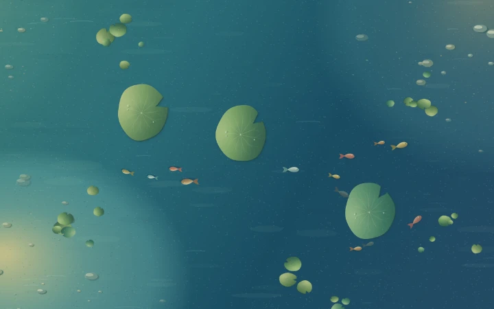

# Sylvaframe


**让桌面图标成为风景的一部分。**

Sylvaframe 是 Windows 动态壁纸。移动桌面图标，森林的溪流会绕开它，湖泊的荷叶会跟着移动，海岛也会重新长出岸线。连接扩展屏幕后，每块屏幕独立绘制自己的风景。

[下载 Windows 版](https://github.com/XiaoyuZhuang/Deskland/releases/latest) · [问题反馈](https://github.com/XiaoyuZhuang/Deskland/issues) · [English](#english)


## 下载和使用

支持 Windows 10 和 11（x64），需要 Microsoft Edge WebView2 Runtime。安装包会在需要时引导安装 WebView2。

1. 从 [GitHub Releases](https://github.com/XiaoyuZhuang/Deskland/releases/latest) 下载 `Setup.exe`，或将便携 ZIP 完整解压后运行 `Start-Forest.cmd`。
2. 从系统托盘打开 Sylvaframe 设置，选择主题。打开主题的「自适应」，然后移动桌面图标，即可看到布局变化。
3. 从托盘暂停、重新载入或退出。退出后恢复 Windows 原壁纸。

桌面壁纸在本机绘制。扩展屏按各自的图标布局调整，设置预览和分享使用主屏布局。分享画面用示例图标替代真实文件名。

## 主题

| 主题 | 桌面上的变化 |
| --- | --- |
| 森林、粉色森林 | 林间空地随图标移动。森林的溪流会绕开进入河道的图标。 |
| 湖泊、荷塘 | 湖泊里的游鱼穿过荷叶下方，荷叶承托图标。荷塘里有荷花与锦鲤。 |
| 沙滩、马尔代夫、大海 | 沙滩随图标改变海岸。马尔代夫和大海有摇动的棕榈和沿岸散开的白色泡沫。 |
| 草地、天空 | 图标融入草地或云团，云和风景持续变化。 |
| 手绘城市、老地图、航海地图 | 绿地、运河或纸上的海陆轮廓随图标重排。 |

设置中有 12 个可用主题。彩色城市提供静态预览图。



## 从源码运行

在 Windows 上打开仓库根目录，运行以下 PowerShell 命令。首次构建会从 NuGet 下载 WebView2 SDK。程序生成在 `host/bin/`，运行时请保留 `host/` 和 `prototype/` 的目录结构。

```powershell
powershell -ExecutionPolicy Bypass -File host\build.ps1
.\Start-Forest.cmd
```

构建安装包可运行 `powershell -ExecutionPolicy Bypass -File tools\build-installer.ps1`，产物在 `dist/`。使用 Node.js 运行 `node prototype/serve.mjs`，可在浏览器里体验示例图标和主题设置。 [本地预览](http://localhost:5178/settings.html) · [Windows 宿主开发说明](host/README.md)

## 致谢与许可

Sylvaframe 是 Deskland Preview 的独立修改版，使用自己的名称和图标。感谢 **BLEZZ0102** 和 Deskland 贡献者开源 Windows 壁纸宿主和基础主题。原始版权、修改日期和上游源码出处见 [NOTICE](NOTICE)。

项目源码及随附主题素材按 [GNU GPL v3](LICENSE) 发布。Windows 发布包提供对应版本的源码。 [第三方许可](THIRD_PARTY_NOTICES.md) · [名称与图标说明](TRADEMARKS.md)

## English

Sylvaframe is an adaptive live wallpaper for Windows 10 and 11 (x64). Desktop icons shape forest clearings, lily pads, shorelines, cities, and clouds. Each extended display renders its own scene. The app includes 12 usable themes.

Download the installer, or extract the entire portable ZIP and run `Start-Forest.cmd`. Open Settings from the tray. The portable build requires Microsoft Edge WebView2 Runtime. [Windows downloads](https://github.com/XiaoyuZhuang/Deskland/releases/latest)

Sylvaframe is an independently branded fork of Deskland Preview. Thanks to BLEZZ0102 and the Deskland contributors for the original host and themes. The source and bundled theme assets use GNU GPL v3. [Copyright and changes](NOTICE) · [License](LICENSE) · [Third-party notices](THIRD_PARTY_NOTICES.md) · [Name and icon](TRADEMARKS.md)
